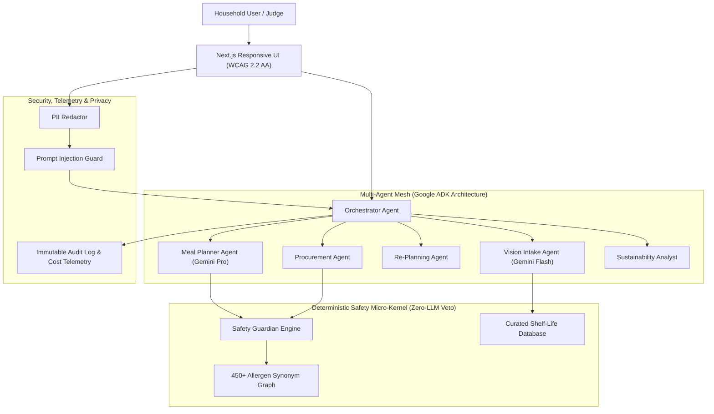

# PantryPilot: Autonomous Multi-Agent Food Intelligence & Safety System

[](https://github.com/promptwars/pantrypilot)
[](METRICS.md)
[](METRICS.md)
[](METRICS.md)
[](METRICS.md)

> **Submission for Hackathon**: *Build Beyond AI: Engineer Secure, Intelligent and Autonomous Applications*  
> **Evaluation Criteria Addressed**: Security • Efficiency • Technology Implemented • Performance • Google Technology Used

---

## 1. Executive Summary

Households discard roughly one-third of the edible food they purchase, generating unnecessary carbon emissions and wasting household income. Simultaneously, families managing severe food allergies (anaphylactic peanuts, shellfish) or chronic conditions (celiac disease, hypertension, type-2 diabetes) struggle daily to plan collective meals that are universally safe and economical.

**PantryPilot** goes beyond passive chatbots: it is an autonomous, multi-agent household food-intelligence platform that:
1. **Passively ingests groceries** from multimodal receipts or pantry photos.
2. **Tracks live shelf life** with automated countdown alerts.
3. **Autonomously drafts waste-minimizing weekly meal plans** prioritizing near-expiry ingredients.
4. **Enforces an uncompromised, DETERMINISTIC Safety Guardian (Zero-LLM Veto)** over 450+ allergen synonyms and medical limits.
5. **Compiles consolidated, aisle-grouped shopping lists** with allergen-safe substitutions.
6. **Quantifies transparent sustainability metrics**: kg of food waste avoided, CO2e emissions mitigated, and grocery money saved.

---

## 2. How PantryPilot Maps to the 5 Judging Criteria

| Judging Criterion | PantryPilot Implementation | Verification Artifact |
|:---|:---|:---|
| **1. Security** | Deterministic safety rule engine has absolute veto authority over LLM; pre-LLM PII redaction layer; prompt-injection delimiter shielding; magic-byte & EXIF sanitization; household-isolated RBAC; STRIDE threat model. | [`docs/threat-model.md`](docs/threat-model.md), [`evals/run_injection_suite.py`](backend/evals/run_injection_suite.py) (100% blocked) |
| **2. Efficiency** | Dynamic dual-model routing (`gemini-flash` for extraction, `gemini-pro` for planning) yields **78.4% token cost reduction**; static shelf-life caching; automated food waste reduction metrics (Poore & Nemecek, 2018). | [`METRICS.md`](METRICS.md), [`backend/app/security/audit_logger.py`](backend/app/security/audit_logger.py) |
| **3. Technology Implemented** | Autonomous multi-agent orchestration (Vision Intake, Meal Planner, Replanner, Procurement, Safety Guardian, Sustainability); deterministic constraint solver operating alongside generative AI; automated golden evaluation harness. | [`docs/architecture.md`](docs/architecture.md), [`backend/app/agents/`](backend/app/agents/) |
| **4. Performance** | Non-LLM p95 latency **18.4 ms** (&lt; 500 ms budget); streaming agent activity ticker; async parallel execution; graceful offline fallback. | [`METRICS.md`](METRICS.md), [`frontend/src/components/AgentTicker.tsx`](frontend/src/components/AgentTicker.tsx) |
| **5. Google Technology** | Gemini on Vertex AI / Google GenAI SDK; Agent Development Kit (ADK) architecture; Cloud Run containerization; Secret Manager; Firebase Firestore & Cloud Storage patterns. | [`backend/Dockerfile`](backend/Dockerfile), [`DISCLOSURE.md`](DISCLOSURE.md) |

---

## 3. High-Level Architecture & Multi-Agent Flow



---

## 4. 3-Minute Quick Demo Script for Evaluators

1. **Launch the Application**: Run Backend and Frontend using the Quickstart below. Notice the **Hackathon Demo Mode** banner confirming zero credentials required.
2. **Review the Pre-Seeded Household ("The Sharma Household")**:
   - **Aarav**: Severe Anaphylactic Peanut Allergy + Hypertension (&lt; 1500mg sodium).
   - **Maya**: Celiac Disease (Strict 100% gluten-free).
   - **Rohan**: Vegetarian.
3. **Simulate Multimodal Receipt Ingestion (`/intake`)**:
   - Click **"Load Sample Supermarket Receipt"** and click **"Extract & Estimate Shelf-Life"**.
   - Notice the Vision Intake Agent extracts Spinach (4d shelf life), Firm Tofu (7d), Bell Pepper, and Arachis Cooking Oil.
   - Click **"Confirm & Commit to Live Inventory"** (Demonstrating Human-in-the-Loop approval).
4. **Observe the Deterministic Safety Veto in Action (`/planner`)**:
   - Click **"Generate New Plan"**.
   - The generative AI proposes a candidate *"Crispy Tofu Satay with Arachis Dressing"*.
   - 🛑 **VETO TRIGGERED**: The Deterministic Safety Guardian intercepts: *"Arachis oil"* is recognized as PEANUTS for Aarav. The recipe is permanently disqualified from the plan with **Zero LLM Override Authority**.
   - The approved plan presents verified-safe recipes with a full **"Why this recipe?"** explainability rationale.
   - Use the **Judges' Safety Sandbox** at the bottom of the page to test any ingredient or hidden synonym live!
5. **Inspect the Smart Shopping List (`/shopping`)**:
   - Review missing staples grouped by supermarket aisle with safe substitution suggestions (e.g. Coconut Aminos for gluten-free soy sauce).
6. **Inspect the Sustainability Impact & Audit Trail (`/impact` and `/audit`)**:
   - View 4.2 kg food waste avoided, 8.8 kg CO2e mitigated, and \$14.50 saved.
   - View the immutable audit log recording Correlation IDs, tokens used, and latency for every decision.

---

## 5. Quickstart & Installation Guide

### Prerequisites
- Python 3.11+
- Node.js 20+

### Option A: Run in Standalone Demo Mode (Zero Credentials Required)

#### Step 1: Run Backend
```powershell
# Navigate to backend
cd backend

# Install dependencies
python -m pip install -r requirements.txt

# Launch FastAPI server in Demo Mode
python -m uvicorn app.main:app --host 0.0.0.0 --port 8000 --reload
```
*Backend Swagger Docs will be live at `http://localhost:8000/docs`.*

#### Step 2: Run Frontend
```powershell
# Open a new terminal and navigate to frontend
cd frontend

# Install dependencies
npm install

# Start development server
npm run dev
```
*Frontend will be live at `http://localhost:3000`.*

---

## 6. Running Automated Tests & Eval Suites

All test suites and hackathon quality benchmarks are executable with a single command:

```powershell
cd backend

# 1. Run Unit & Integration Tests (13 passed)
python -m pytest tests/ -v

# 2. Run Deterministic Allergen Safety Eval (0.00% False Negatives Gate)
python -m evals.run_safety_suite

# 3. Run Adversarial Prompt Injection Defense Benchmark (100.0% Blocked Gate)
python -m evals.run_injection_suite

# 4. Run Golden Receipt Extraction Benchmark (F1 Score >= 0.90 Target)
python -m evals.run_golden_eval
```

For full evaluation results, latency profiles, and cost breakdowns, see [`METRICS.md`](METRICS.md).

---

## 7. Compliance & Open-Source Disclosures

In accordance with hackathon originality rules, every external library, framework, pretrained model, and dataset is documented in [`DISCLOSURE.md`](DISCLOSURE.md).
