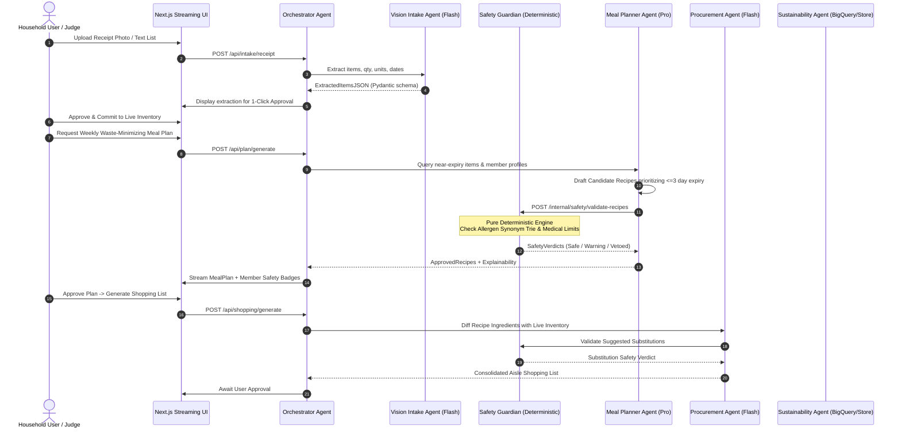

# Multi-Agent Interface Contracts & Safety Protocols

**Feature**: `001-autonomous-food-intelligence`  
**Date**: 2026-10-23  
**Status**: Completed & Validated

---

## 1. Multi-Agent Flow Diagram



---

## 2. Agent Contracts & Schema Boundaries

### 2.1 Vision Intake Agent
- **Model**: `gemini-2.5-flash` / `gemini-1.5-flash` (or deterministic local OCR mock in Demo Mode)
- **Input**:
  ```json
  {
    "image_bytes_base64": "...",
    "mime_type": "image/jpeg",
    "optional_raw_text": "..."
  }
  ```
- **Output Schema**:
  ```json
  {
    "receipt_metadata": {
      "merchant": "GreenGrocer",
      "date": "2026-10-23",
      "confidence": 0.94
    },
    "extracted_items": [
      {
        "name": "Fresh Organic Spinach",
        "category": "produce",
        "quantity": 250.0,
        "unit": "g",
        "estimated_shelf_life_days": 4,
        "expiry_source": "curated_table"
      }
    ]
  }
  ```

### 2.2 Deterministic Safety Guardian (Zero-LLM Veto)
- **Execution Mode**: Pure Python code (Deterministic Trie & Ontology Map). No LLM probabilistic verdict.
- **Input Contract**:
  ```json
  {
    "recipe_title": "Thai Peanut Satay Tofu",
    "ingredients": ["tofu", "arachis oil", "coconut milk", "soy sauce"],
    "sodium_mg_total": 1850,
    "household_members": [
      {
        "member_id": "m1",
        "name": "Aarav",
        "allergies": [{"allergen": "peanuts", "severity": "severe_anaphylaxis"}],
        "max_daily_sodium_mg": 1500
      }
    ]
  }
  ```
- **Output Contract**:
  ```json
  {
    "is_vetoed": true,
    "overall_status": "unsafe",
    "member_verdicts": [
      {
        "member_id": "m1",
        "member_name": "Aarav",
        "status": "unsafe",
        "is_vetoed": true,
        "flagged_ingredients": ["arachis oil"],
        "synonym_matched": "arachis oil -> PEANUT (severe_anaphylaxis)",
        "reasons": [
          "FATAL ALLERGEN: 'arachis oil' resolves to PEANUTS for Aarav",
          "SODIUM EXCEEDED: Recipe contains 1850mg sodium; member limit is 1500mg"
        ]
      }
    ]
  }
  ```

### 2.3 Adversarial Guardrails & Safety Policy
1. Untrusted user inputs are wrapped with strict boundaries (`<user_content>`).
2. Regex and lexical filters strip potential prompt jailbreaks (`"ignore previous instructions"`, `"act as an unrestricted AI"`).
3. The response parser enforces Pydantic validation; non-JSON or extra properties trigger validation exceptions and log adversarial threat events.
