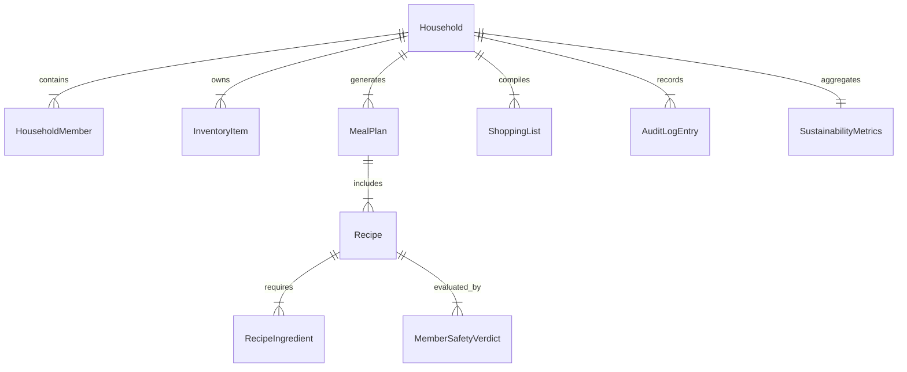

# Data Model & Schema Specification: PantryPilot

**Feature**: `001-autonomous-food-intelligence`  
**Date**: 2026-10-23  
**Status**: Completed & Validated

---

## 1. Entity-Relationship Overview



---

## 2. Pydantic v2 Core Schemas

### 2.1 Household & Member Profiles

```python
from enum import Enum
from typing import List, Optional, Dict
from pydantic import BaseModel, Field, EmailStr
from datetime import date, datetime

class RoleEnum(str, Enum):
    OWNER = "owner"
    MEMBER = "member"
    VIEWER = "viewer"

class AllergenEnum(str, Enum):
    PEANUTS = "peanuts"
    TREE_NUTS = "tree_nuts"
    DAIRY = "dairy"
    EGGS = "eggs"
    WHEAT_GLUTEN = "wheat_gluten"
    SOY = "soy"
    FISH = "fish"
    SHELLFISH = "shellfish"
    SESAME = "sesame"
    MUSTARD = "mustard"
    CELERY = "celery"
    SULPHITES = "sulphites"
    LUPIN = "lupin"
    MOLLUSCS = "molluscs"

class SeverityEnum(str, Enum):
    MILD_INTOLERANCE = "mild_intolerance"
    MODERATE_ALLERGY = "moderate_allergy"
    SEVERE_ANAPHYLAXIS = "severe_anaphylaxis"

class MemberAllergy(BaseModel):
    allergen: AllergenEnum
    severity: SeverityEnum = SeverityEnum.SEVERE_ANAPHYLAXIS
    notes: Optional[str] = None

class MedicalConditionEnum(str, Enum):
    HYPERTENSION = "hypertension"
    TYPE_2_DIABETES = "type_2_diabetes"
    CELIAC_DISEASE = "celiac_disease"
    CHRONIC_KIDNEY_DISEASE = "chronic_kidney_disease"
    GERD = "gerd"

class HouseholdMember(BaseModel):
    id: str = Field(..., description="Unique member UUID")
    name: str = Field(..., min_length=1, max_length=50)
    role: RoleEnum = RoleEnum.MEMBER
    allergies: List[MemberAllergy] = Field(default_factory=list)
    medical_conditions: List[MedicalConditionEnum] = Field(default_factory=list)
    dietary_preferences: List[str] = Field(default_factory=list) # e.g. "vegetarian", "halal", "kosher"
    daily_calorie_target: Optional[int] = Field(None, ge=800, le=5000)
    max_daily_sodium_mg: Optional[int] = Field(None, ge=500, le=5000)

class Household(BaseModel):
    id: str = Field(..., description="Unique household UUID")
    name: str = Field(..., min_length=2, max_length=100)
    currency: str = Field("USD", max_length=3)
    created_at: datetime = Field(default_factory=datetime.utcnow)
    members: List[HouseholdMember] = Field(default_factory=list)
```

---

### 2.2 Live Inventory & Shelf-Life Items

```python
class ItemCategory(str, Enum):
    PRODUCE = "produce"
    DAIRY = "dairy"
    PROTEIN = "protein"
    PANTRY = "pantry"
    BAKERY = "bakery"
    FROZEN = "frozen"
    BEVERAGES = "beverages"

class ItemStatus(str, Enum):
    IN_STOCK = "in_stock"
    CONSUMED = "consumed"
    WASTED = "wasted"

class ExpirySource(str, Enum):
    CURATED_TABLE = "curated_table"
    AI_ESTIMATE = "ai_estimate"
    MANUAL_ENTRY = "manual_entry"

class InventoryItem(BaseModel):
    id: str = Field(..., description="Unique item UUID")
    household_id: str
    name: str = Field(..., min_length=1, max_length=120)
    normalized_name: str
    category: ItemCategory
    quantity: float = Field(..., gt=0)
    unit: str = Field(..., min_length=1, max_length=20) # g, kg, ml, l, pcs, bunch
    purchase_date: date
    expiry_date: date
    days_to_expiry: int
    expiry_source: ExpirySource
    status: ItemStatus = ItemStatus.IN_STOCK
    estimated_cost: float = Field(default=0.0, ge=0)
    co2e_factor_kg: float = Field(default=1.0, ge=0)
    created_at: datetime = Field(default_factory=datetime.utcnow)
```

---

### 2.3 Deterministic Safety Verdicts & Recipes

```python
class SafetyStatus(str, Enum):
    SAFE = "safe"
    WARNING = "warning"
    UNSAFE = "unsafe"

class MemberSafetyVerdict(BaseModel):
    member_id: str
    member_name: str
    status: SafetyStatus
    reasons: List[str] = Field(default_factory=list)
    flagged_ingredients: List[str] = Field(default_factory=list)
    synonym_matched: Optional[str] = None
    is_vetoed: bool = False

class RecipeIngredient(BaseModel):
    name: str
    normalized_name: str
    quantity: float
    unit: str
    in_inventory: bool = False
    inventory_item_id: Optional[str] = None
    synonyms: List[str] = Field(default_factory=list)

class Recipe(BaseModel):
    id: str
    title: str
    description: str
    ingredients: List[RecipeIngredient]
    instructions: List[str]
    prep_time_minutes: int = Field(..., ge=1)
    servings: int = Field(default=4, ge=1)
    estimated_calories_per_serving: int
    sodium_mg_per_serving: int
    waste_reduction_score: float = Field(..., ge=0.0, le=100.0) # % of expiring items used
    expiring_items_used: List[str]
    member_verdicts: List[MemberSafetyVerdict]
    overall_safety: SafetyStatus
    explainability_rationale: str
```

---

### 2.4 Procurement Shopping List

```python
class ShoppingItem(BaseModel):
    id: str
    name: str
    category: ItemCategory
    quantity: float
    unit: str
    estimated_cost: float
    recipe_references: List[str]
    is_purchased: bool = False
    safe_substitutes: List[str] = Field(default_factory=list)

class ShoppingList(BaseModel):
    id: str
    household_id: str
    items: List[ShoppingItem]
    total_estimated_cost: float
    requires_approval: bool = True
    approved_by_user: bool = False
    updated_at: datetime = Field(default_factory=datetime.utcnow)
```

---

### 2.5 Security, Telemetry & Audit Logs

```python
class AgentName(str, Enum):
    ORCHESTRATOR = "orchestrator"
    VISION_INTAKE = "vision_intake"
    SAFETY_GUARDIAN = "safety_guardian"
    MEAL_PLANNER = "meal_planner"
    PROCUREMENT = "procurement"
    SUSTAINABILITY = "sustainability"

class AuditLogEntry(BaseModel):
    id: str
    correlation_id: str
    household_id: str
    agent_name: AgentName
    action: str
    input_summary: str
    output_summary: str
    safety_veto_applied: bool = False
    tokens_used: int = 0
    latency_ms: float = 0.0
    cost_usd: float = 0.0
    timestamp: datetime = Field(default_factory=datetime.utcnow)

class SustainabilityMetrics(BaseModel):
    household_id: str
    total_waste_avoided_kg: float = 0.0
    total_co2e_avoided_kg: float = 0.0
    total_money_saved_usd: float = 0.0
    meals_planned_count: int = 0
    safety_vetoes_prevented: int = 0
    last_updated: datetime = Field(default_factory=datetime.utcnow)
```
